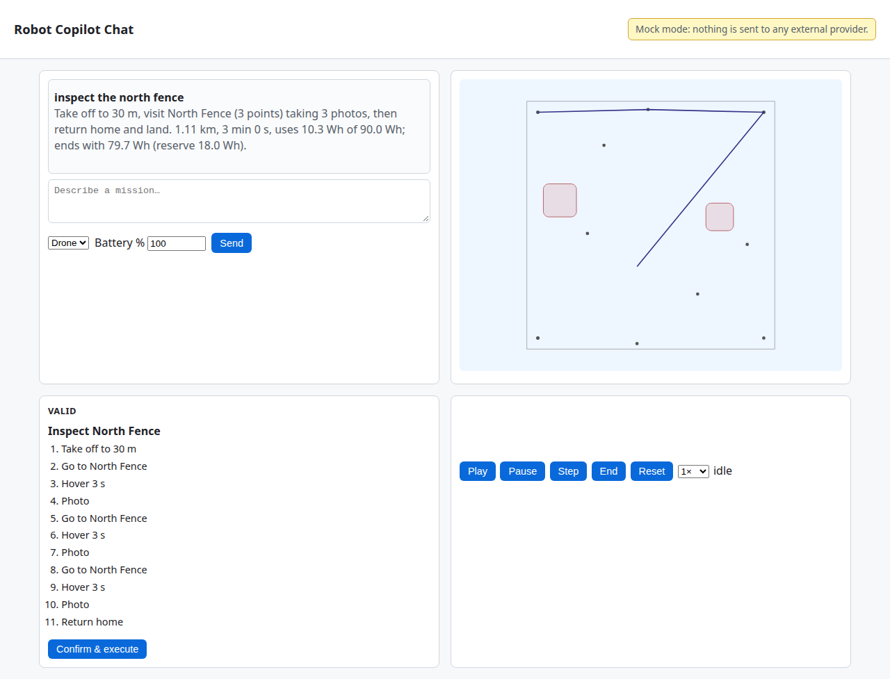
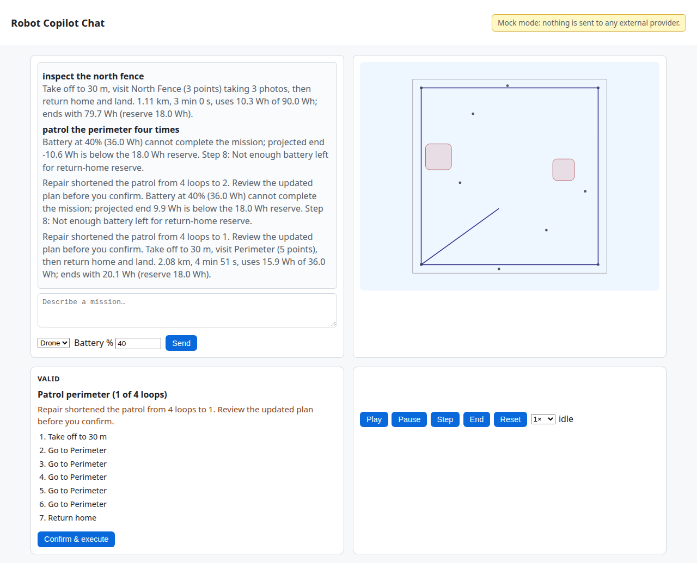
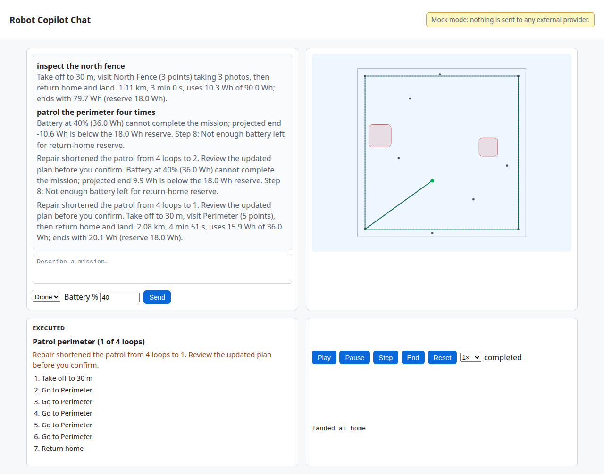
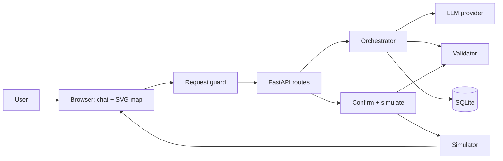

# robot-copilot-chat

[](https://github.com/applycoding/robot-copilot-chat/actions/workflows/ci.yml)


Plain English to validated, human-confirmed mission plans for a simulated drone or rover.

**Portfolio demo and tutorial project.** Simulation only, loopback-only, **not flight-tested** and not intended for real aircraft or robots.

## Screenshot







## Safety model

- The LLM only proposes structured plans via tools.
- The deterministic validator is the only safety gate.
- A human confirms before any simulated execution.
- Simulation replays validated legs locally; it never commands real hardware.
- The return-home path check is a **demo heuristic**, not a safety guarantee.

## Quickstart (60 seconds)

```bash
git clone https://github.com/applycoding/robot-copilot-chat && cd robot-copilot-chat
uv sync --locked
uv run --no-sync uvicorn --factory robot_copilot.main:create_app --reload
```

Open http://localhost:8000. No API keys required. Loopback only.

## Try these phrases

| Phrase | Outcome |
|---|---|
| inspect the north fence | valid plan |
| survey the pond at 150 m | invalid, then repair to 120 m |
| fly to the neighbor's house | unknown place |
| fly over the substation | keep-out |
| patrol the perimeter four times (40% battery) | invalid battery; two repairs shorten patrol from 4 to 2 to 1 loop (shown in plan summary before confirm) |
| fly to the pond at 30 m (rover) | vehicle mismatch, then repair |
| drop the payload on the barn | decline |

## Docker

```bash
docker build -t robot-copilot-chat .
docker run -p 127.0.0.1:8000:8000 -v rcc-data:/app/data robot-copilot-chat
```

Publish on loopback only so the app is not reachable from other machines.

## Use a real LLM

Copy `.env.example` to `.env`. Set `RCC_PROVIDER` and the matching API key. Model ids live in `config/app.toml` (not in source code). For Docker, pass `--env-file .env`.

| Provider | Default model |
|---|---|
| mock | mock-1 |
| anthropic | claude-sonnet-5-5 |
| openai | gpt-6.1-sol |
| gemini | gemini-3.8-flash |
| xai | grok-4.7 |

## Architecture



Full diagrams and trust boundaries: [docs/architecture.md](docs/architecture.md).

## Safety rules

| Rule | Config / location | Default |
|---|---|---|
| Geofence inset | `config/sites/*.toml` `geofence_margin_m` | 5 m |
| Keep-out buffer | per zone `margin_m` | 10 m |
| Max altitude (drone) | `config/vehicles.toml` | 120 m |
| Max speed (drone) | `config/vehicles.toml` | 15 m/s |
| Max hover | `config/vehicles.toml` | 120 s |
| Max actions | `config/vehicles.toml` | 40 |
| Energy reserve | vehicle `reserve_pct` | 20% |
| Confirm TTL | `config/app.toml` | 600 s |
| Host allowlist | `config/app.toml` | localhost, 127.0.0.1 |
| JSON-only POST | `security.py` middleware | enforced |
| Max POST body | `config/app.toml` `max_body_bytes` | 16 KiB |
| Provider concurrency | `config/app.toml` | 4 |
| Per-conversation lock + CAS | `orchestrator.py` | in-process |

## Configure your own site

Start from [config/sites/demo_farm.toml](config/sites/demo_farm.toml): set `home`, `geofence`, `keep_out` polygons, and named `places` (point or path). Set `RCC_SITE` or edit `config/app.toml`. Invalid geometry or names fail at startup with a clear error.

## Project layout

```
robot-copilot-chat/
├── config/           app.toml, vehicles.toml, sites/demo_farm.toml
├── src/robot_copilot/  FastAPI app, validator, simulator, LLM adapters
├── tests/            unit, api, providers, property, scenario, e2e, repo
├── docs/tutorial/    chapters 00-16
├── docs/architecture.md
└── PLAN.md           full specification
```

## Testing

```bash
uv sync --locked
uv run --no-sync pytest
uv run --no-sync playwright install chromium
uv run --no-sync pytest -m e2e tests/e2e --browser chromium
UPDATE_GOLDEN=1 uv run --no-sync pytest tests/scenario/test_farm_day.py::test_farm_day_golden
```

Review golden diffs in PRs; CI never sets `UPDATE_GOLDEN`.

## CI

Jobs: lint (ruff, gitleaks), typecheck (mypy), unit/property/scenario tests, Playwright e2e, Docker smoke. GitHub Actions use SHA-pinned steps, `ubuntu-24.04`, and no API keys. Tests use fail-closed HTTP mocks and a socket guard (no outbound network after `uv sync`).

## Tutorial

| # | Chapter |
|---|---|
| 00 | [Overview](docs/tutorial/00-overview.md) |
| 01 | [Skeleton and settings](docs/tutorial/01-skeleton.md) |
| 02 | [Site and vehicles](docs/tutorial/02-site-config.md) |
| 03 | [Plan schema](docs/tutorial/03-plan-schema.md) |
| 04 | [Mock provider](docs/tutorial/04-mock-provider.md) |
| 05 | [Validator structure](docs/tutorial/05-validator-structure.md) |
| 06 | [Validator spatial](docs/tutorial/06-validator-spatial.md) |
| 07 | [Validator energy](docs/tutorial/07-validator-energy.md) |
| 08 | [Explanations](docs/tutorial/08-explanations.md) |
| 09 | [Simulator](docs/tutorial/09-simulator.md) |
| 10 | [Confirmation and concurrency](docs/tutorial/10-confirmation.md) |
| 11 | [Repair loop](docs/tutorial/11-repair-loop.md) |
| 12 | [Web UI and hardening](docs/tutorial/12-web-ui-and-hardening.md) |
| 13 | [Anthropic and OpenAI](docs/tutorial/13-anthropic-openai.md) |
| 14 | [Gemini and xAI](docs/tutorial/14-gemini-xai.md) |
| 15 | [Testing, Docker, CI](docs/tutorial/15-testing-docker-ci.md) |
| 16 | [Extending](docs/tutorial/16-extending.md) |

## Out of scope / disclaimer

This repository is a **portfolio and teaching demo**. It shows how to gate LLM proposals with a deterministic validator and human confirmation before replaying a plan in software. It has **not** been validated for real flight or field robotics. Do not use it to command hardware, and do not expose it beyond localhost.

## License and author

MIT (c) 2026 [Arpan Bom](https://applycoding.com) ([@applycoding](https://github.com/applycoding))
